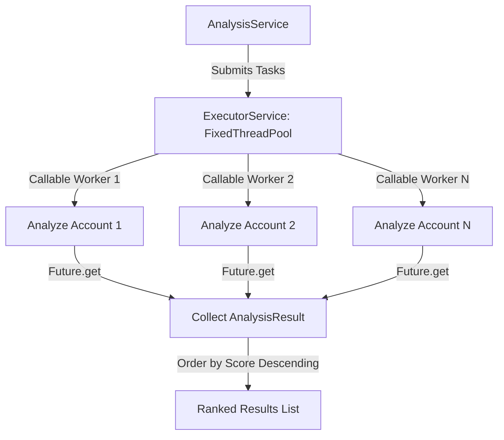

# Architecture and Design Documentation

## 1. Executive Architectural Overview

The **Dead Internet & Fake Engagement Detector** is engineered as a decoupled, multi-layered Java console application. The architecture strictly adheres to Object-Oriented Programming (OOP) principles, Clean Architecture separation of concerns, and classic GoF (Gang of Four) design patterns.

The primary system objective is to parse social media profile records, extract heuristic features, evaluate automated behavior rules, calculate explainable risk scores (0–100), and generate audit reports.

---

## 2. Package Architecture

```
com.detector/
├── main/
│   └── Main.java                     # Application entry point, console UI & loop
├── model/
│   ├── SocialMediaAccount.java       # Account profile data model
│   ├── AccountActivity.java          # Activity & comment observation metrics
│   ├── AnalysisResult.java           # Risk assessment results & explanations
│   └── RiskLevel.java                # Enum: LOW, MEDIUM, HIGH
├── validation/
│   ├── DataValidator.java            # Defensive input validation rules
│   └── ValidationResult.java         # Validation outcome DTO
├── manager/
│   └── AccountManager.java           # In-memory storage & O(1) index management
├── analysis/
│   ├── DetectionRule.java            # Strategy interface for heuristics
│   ├── NewAccountRule.java           # Checks account age threshold
│   ├── RepetitiveCommentRule.java    # Checks duplicate comment ratio
│   ├── UnusualEngagementRule.java    # Checks engagement rate anomaly
│   ├── RapidActivityRule.java        # Checks 10-minute burst comment frequency
│   ├── SuspiciousFollowRatioRule.java# Checks following-to-follower disparity
│   ├── RiskScoreCalculator.java      # Score summation, capping, & classification
│   └── RiskAnalyzer.java             # Orchestrates rule execution pipeline
├── service/
│   └── AnalysisService.java          # Concurrency coordinator (ExecutorService)
├── input/
│   ├── CSVReader.java                # Fault-tolerant CSV file parsing
│   └── ManualInput.java              # Interactive validated console input
└── report/
    └── ReportGenerator.java          # CSV & TXT report generation
```

---

## 3. Core Object-Oriented Principles Demonstrated

### 3.1 Encapsulation
- All class attributes in `SocialMediaAccount`, `AccountActivity`, `AnalysisResult`, etc., are marked `private`.
- Mutators (`setters`) validate preconditions and invariants defensively (e.g., throwing `IllegalArgumentException` on negative values or blank strings).
- `getAllAccounts()` returns an unmodifiable list view (`Collections.unmodifiableList`), preventing external modification of internal collections.

### 3.2 Abstraction & Strategy Pattern
- The `DetectionRule` interface abstracts the contract for inspecting an account.
- Individual rules (`NewAccountRule`, `RepetitiveCommentRule`, `UnusualEngagementRule`, `RapidActivityRule`, `SuspiciousFollowRatioRule`) encapsulate their specific heuristic mathematical logic and thresholds.
- Adding a new detection rule (e.g., `SentimentVarianceRule` or `HashtagSpamRule`) requires zero modification to `RiskAnalyzer` or `AnalysisService`—it simply implements `DetectionRule` and is registered with the engine.

### 3.3 Separation of Concerns
- **Data Model vs. Analysis Output**: Raw account data (`SocialMediaAccount`) remains completely unpolluted by analysis results (`AnalysisResult`). An account can be re-analyzed with different parameters without mutating its state.
- **Service vs. UI**: `Main.java` handles only user interaction, input routing, and formatted display. All business orchestration resides in `AnalysisService`.

---

## 4. Data Structures & Collections Framework Usage

| Collection | Class | Justification & Complexity |
| :--- | :--- | :--- |
| `ArrayList<SocialMediaAccount>` | `AccountManager` | Preserves insertion order, supports fast indexed iteration ($O(1)$) and iteration over all accounts. |
| `HashMap<String, SocialMediaAccount>` | `AccountManager` | Provides constant-time $O(1)$ retrieval of accounts by unique `accountId`. |
| `HashSet<String>` | `AccountManager` | Enforces primary key uniqueness and allows instant $O(1)$ duplicate checking before registration. |
| `List<DetectionRule>` | `RiskAnalyzer` | Configurable list of active detection rules. |
| `Collections.sort()` | `AnalysisService` | Uses TimSort ($O(N \log N)$) implementing `Comparable<AnalysisResult>` to rank accounts by risk score descending. |

---

## 5. Multithreading & Concurrency Architecture

Multithreading is implemented using Java's standard **Concurrency Utilities** (`java.util.concurrent`):



### Key Concurrency Safeguards:
1. **Thread Pool Management**: An `ExecutorService` with a fixed thread pool is provisioned dynamically (clamped between 1 and available CPU cores: `Runtime.getRuntime().availableProcessors()`).
2. **Task Independence (`Callable<AnalysisResult>`)**: Each account analysis is encapsulated in an independent `Callable` task.
3. **Absence of Shared Mutable State**: Detection rules and account instances are immutable or thread-confined during analysis. No thread modifies another thread's working data.
4. **Orderly Lifecycle Shutdown**: The service cleanly invokes `executor.shutdown()` followed by `awaitTermination(5, TimeUnit.SECONDS)`, falling back to `shutdownNow()` if tasks fail to conclude promptly.
5. **Deterministic Consistency**: `MultithreadingConsistencyTest` formally asserts that parallel execution produces the exact same score, risk classification, and triggered rules as sequential execution.

---

## 6. Error & Exception Handling Strategy

- **Predictable Exceptions**: Negative inputs or blank IDs throw explicit `IllegalArgumentException` with descriptive messages.
- **File I/O Fault Tolerance**: `CSVReader` handles missing files (`IOException`), skips malformed rows, logs row-specific errors with line numbers, and continues processing without crashing.
- **Rule Failure Shielding**: `RiskAnalyzer` evaluates individual rules within a `try-catch` block. If a single rule throws an unexpected exception, it is recorded in the explanation log while allowing remaining rules and accounts to complete normally.
- **No Empty Catch Blocks**: Every catch block logs the error, rethrows, or returns structured failure diagnostics.
